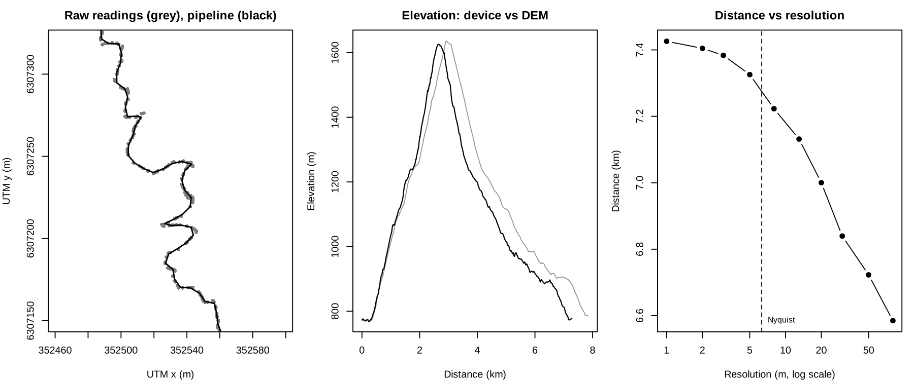

# Metric Trails

<!-- badges: start -->
<!-- badges: end -->

**metrictrails** is an R package to read, clean and standardise GNSS streams
recorded by sports watches and similar devices, with a focus on trail and
mountain running. It implements the methods of
the Metric Trails research papers (see [References](#references)).

A *stream* is any sequence of consecutive readings with `lon` and `lat`, and
optionally `ele`, `timestamp`, `time`, heart rate, cadence and other variables.

## Installation

```r
install.packages("metrictrails")
```

## The pipeline

A full walkthrough is in the vignette: `vignette("metrictrails")`.




| step | function | what it does |
|---|---|---|
| 1. ingest | `read_stream()` | reads a GPX file with sf (tracks or routes, segments and Garmin extensions) |
| 2. naming convention | `uniform_stream()` | renames columns to `lon, lat, ele, timestamp, time` |
| 3. sanitize | `sanitize_stream()` | smooths `lon/lat` (Kalman by default; LOESS, Gaussian kernel, Savitzky-Golay or the full ICECET 2026 pipeline) and flags implausible readings |
| 4. resample | `resolution_stream()`, `resample_stream()` | resamples to a uniform 2D spatial resolution derived from the Nyquist criterion |
| 5. elevation | `get_dem()`, `resample_dem()`, `ele_correction()` | replaces elevation with values from a Digital Elevation Model |

```r
library(metrictrails)

f = system.file("extdata", "gpx_activity.gpx", package = "metrictrails")
dem = system.file("extdata", "test_dem.tif", package = "metrictrails")

raw = read_stream(f) %>% uniform_stream()
raw
#> # A tibble: 2,510 x 9
#>     lon   lat   ele timestamp            time segment atemp    hr   cad
#>   <dbl> <dbl> <dbl> <dttm>              <dbl>   <int> <dbl> <dbl> <dbl>
#> 1 -70.6 -33.4  772  2020-08-10 19:36:38     0       1    27   106    47
#> 2 -70.6 -33.4  771  2020-08-10 19:36:39     1       1    27   108    47
#> 3 -70.6 -33.4  772. 2020-08-10 19:36:42     4       1    27   111    76
#> # i 2,507 more rows

final = raw %>%
  sanitize_stream() %>%       # Kalman smoothing + red flags
  resample_stream() %>%       # Nyquist resolution
  ele_correction(dem = dem)   # DEM elevation (omit `dem` to download one)
```

### Sanitize: smoothing and red flags

Flags are computed on the raw readings. Position flags (time, speed,
acceleration, edge jumps) and elevation flags (slope, vertical speed, elevation
change while idle) can be kept, dropped or interpolated (`action`).

```r
clean = sanitize_stream(raw)
attr(clean, "sanitize_report")$counts
#>       flag_time      flag_speed      flag_accel       flag_jump      flag_slope
#>               0               0               0               0              71
#> flag_vert_speed   flag_idle_ele        flag_gap    flag_low_res
#>               3               3               0              10
```

### Resample: the Nyquist resolution

A watch that records at a fixed rate produces a spatial resolution that is a
random variable (speed times sampling interval), so distance and elevation gain
depend on how fast the athlete moved. `resolution_stream()` describes the
distribution of the 2D distance between moving readings. Its 0.9 quantile is
the finest uniform spacing that represents the path without inventing
readings, and `resample_stream()` uses it by default. To compare several
streams, resample all of them with one common `res`.

```r
resolution_stream(clean)
#> # A tibble: 1 x 12
#>       n pct_idle  mean    sd   q05   q25   q50   q75   q95   max     q   res
#>   <int>    <dbl> <dbl> <dbl> <dbl> <dbl> <dbl> <dbl> <dbl> <dbl> <dbl> <dbl>
#> 1  2510   0.0797  2.97  3.07 0.512  1.08  2.00  3.49  9.10  22.8   0.9  6.31
```

### Elevation from a DEM

`get_dem()` downloads AWS Terrain Tiles (zoom 14, about 4 m at the latitude of
Santiago) for the extent of the stream and projects them to its UTM zone.
`resample_dem()` refines the DEM by bilinear interpolation, or aggregates it.

## Measures

```r
cols = c("distance_2d", "elevation_gain", "km_effort", "resolution", "fractal_dim")
summarise_stream(raw, fractal = TRUE)[, cols]     # raw device
#> # A tibble: 1 x 5
#>   distance_2d elevation_gain km_effort resolution fractal_dim
#>         <dbl>          <dbl>     <dbl>      <dbl>       <dbl>
#> 1       7847.           889.      16.7       3.13        1.07
summarise_stream(final, fractal = TRUE)[, cols]   # after the pipeline
#> # A tibble: 1 x 5
#>   distance_2d elevation_gain km_effort resolution fractal_dim
#>         <dbl>          <dbl>     <dbl>      <dbl>       <dbl>
#> 1       7281.           951.      16.8       6.16        1.08

tobler_stream(final)   # speed-slope frontier (90th percentile)
#> # A tibble: 1 x 8
#>      v1    m1 c_plus c_minus   tau     n    r1 method
#>   <dbl> <dbl>  <dbl>   <dbl> <dbl> <int> <dbl> <chr>
#> 1  3.30 0.148   3.40 -0.0248   0.9  1083 0.236 pinball
```

* `differential_stream()`: per-reading distance, elevation change, slope, heading change, speed, acceleration and pace.
* `summarise_stream()`: 2D and 3D distance, elevation gain and loss, slope, sinuosity, km-effort, idle time and fractal dimension, per stream or per group.
* `fractal_stream()`: fractal dimension of the path with the divider (Richardson) method.
* `tobler_stream()`, `tobler_speed()`: asymmetric Tobler hiking function fitted to a speed quantile (quantile regression in base R).

## Two-stream operations

```r
route = read_stream(system.file("extdata", "gpx_route.gpx", package = "metrictrails"))

# predicate: does the stream follow the route, and where?
detect_stream(raw, route)
#> # A tibble: 1 x 6
#>    pass start_row end_row direction coverage status
#>   <int>     <int>   <int> <chr>        <dbl> <chr>
#> 1     1         1    2506 forward          1 match

# transformation: where was the athlete along a known reference at each time?
ref = route %>% resample_stream(res = 2) %>% ele_correction(dem = dem)
matched = match_stream(clean, ref, params = tobler_stream(final))
summary(matched$offset_d)   # distance from each reading to its matched position
#>     Min.  1st Qu.   Median     Mean  3rd Qu.     Max.
#>  0.05679  4.30900  7.17398  8.98717 11.64175 45.55705
```

* `project_stream()`: adds UTM coordinates `x`, `y` (the projection used internally for every distance).
* `locate_stream()`: linear referencing; position along a reference and signed cross-track distance of every reading, without constraints.
* `compare_stream()`: Hausdorff distance, separation and Metric Score between two streams.
* `detect_stream()`: passes of a stream along a route, with direction and coverage.
* `match_stream()`: map matching to a reference trail that the athlete is known to have followed. The match is monotone and limited by the Tobler speed ceiling, and the global optimum is found by dynamic programming (Viterbi). It returns the matched position and the offset of every reading, split into along-track and cross-track components.
* `write_stream()`: writes a stream to GPX.

## Data

* `strava_streams`, `strava_metadata`: streams and metadata of two activities from the Strava API.
* `inst/extdata`: a GPX activity with heart rate, cadence and temperature, the same loop as a GPX route, and a small DEM of the area.

## References

* Sanchez, R., & Villena, M. (2020). Comparative evaluation of wearable devices for measuring elevation gain in mountain physical activities. *Proc IMechE Part P: Journal of Sports Engineering and Technology*, 234(4), 312-319. <https://doi.org/10.1177/1754337120918975>
* Sanchez, R., Egli, P., Besomi, M., & Truffello, R. (2024). Assessing the impact of Digital Elevation Model resolution on elevation gain estimations in trail running. *ICECET 2024*. <https://doi.org/10.1109/ICECET61485.2024.10698606>
* Sanchez, R., Egli, P. E., Jornet, K., Duggan, M., & Besomi, M. (2025). How fractal complexity distorts distance and elevation gain in trail and mountain running: The case for course measurement standardization. *Proc IMechE Part P*. <https://doi.org/10.1177/17543371251341660>
* Sanchez, R., Nieto-Jimenez, C., & Riveros-Matthey, C. (2025). High-precision mapping of mountain terrain for human locomotion research: A multimodal geospatial framework. *ICPRS 2025*. <https://doi.org/10.1109/ICPRS66293.2025.11302827>
* Sanchez, R. (2025). Human trajectory mapping in ecological contexts: a framework for reliable space-time localization. *ANZSCPB Conference 2025*.
* Martinez, C., Sanchez, R., & Diaz, C. (2026). A post-processing methodology for improving kinematic consistency in GNSS-based running trajectories. *ICECET 2026*. <https://doi.org/10.1109/ICECET65726.2026.11632531>

Use `citation("metrictrails")` to cite the package.

## License

MIT © Raimundo Sanchez
